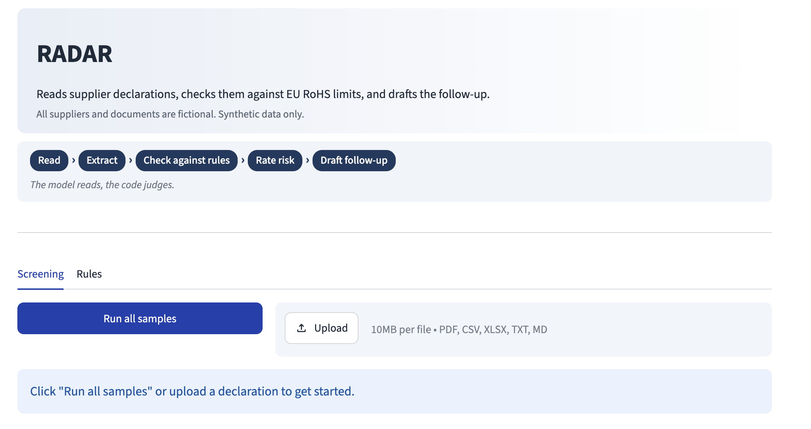
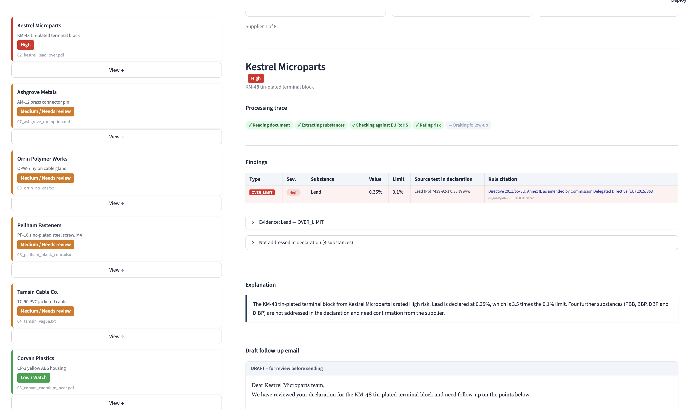

# RADAR

Reads supplier material declarations, checks every substance against EU RoHS limits, and drafts the follow-up.



## What it does

Supplier material declarations arrive in every format: clean tables, PDFs, messy CSV exports, plain-text emails. RADAR reads them, identifies every declared substance, and checks each one against the EU RoHS restricted-substance limits using deterministic Python rules. It rates the supplier's overall risk level and drafts a follow-up email listing exactly what is missing or non-compliant, ready for a person to review and send.

## The model reads, the code judges

Claude extracts structured data from a document: substance names, CAS numbers, concentrations, exemption claims, and the exact source text each value came from. Every compliance decision that follows is made by deterministic Python. Limit comparisons, risk ratings, and finding classifications are computed from the rule files, not inferred by the model. Anything the engine cannot resolve with certainty, such as a vague value, a missing CAS number, or an exemption claim, is flagged for human review rather than estimated. The model never reads, writes, or modifies the rule files.

## How it works

```
Read  >  Extract  >  Check against rules  >  Rate risk  >  Draft follow-up
```

1. **Read.** Load the declaration from `.md`, `.txt`, `.csv`, `.pdf`, or `.xlsx`.
2. **Extract.** Claude returns structured JSON: supplier, component, and per substance: name, CAS number, concentration, unit, exemption claim, and the exact source text.
3. **Check against rules.** Deterministic Python compares each substance to the active EU RoHS rule pack. Unit conversion (ppm to %) happens in Python.
4. **Rate risk.** Any `OVER_LIMIT` finding produces High. Any Medium finding produces Medium / Needs review. `NEAR_LIMIT` only produces Low with a watch flag. Otherwise Low.
5. **Draft follow-up.** Claude writes a plain-English explanation and a supplier email using only the findings already computed. A guard checks that every substance and number in the output appears in those findings.

## What it catches

| Finding | Severity | Meaning |
|---|---|---|
| `OVER_LIMIT` | High | Declared concentration exceeds the substance limit |
| `NEAR_LIMIT` | Low + watch | At or above 80% of the limit |
| `MISSING_CAS` | Medium | No CAS number supplied; value is still checked by name |
| `MISSING_CONCENTRATION` | Medium | No concentration value given at all |
| `UNVERIFIABLE` | Medium | Vague text, unitless number, or a bound that cannot be compared to a limit |
| `EXEMPTION_CLAIMED` | Medium | Supplier claims an exemption; routed to human review with value vs. base limit shown |
| `UNTRACEABLE_EXTRACTION` | Medium | Extracted substance's source text cannot be located in the document |
| `IDENTITY_CONFLICT` | Medium | Name and CAS number point to different restricted substances; evaluated under both readings |
| `NO_SUBSTANCES_ADDRESSED` | Medium | Declaration does not address any restricted substance |
| `NOT_DECLARED` | Info | Restricted substance not mentioned; never changes the rating |

## Detail view



*Finding table with source text, rule citation, risk explanation, and draft follow-up email.*

## Built to be trusted

- **Source text on every finding.** Each finding records the exact text from the declaration that produced it and the rule ID (`eu_rohs@<version>#<substance>`) it was judged against.
- **Extraction traceability.** If the source text an extraction claims cannot be found verbatim in the document, the finding is `UNTRACEABLE_EXTRACTION` (Medium), never a clean pass.
- **Output guards.** The follow-up email is checked in Python: any substance or number that does not appear in the findings is rejected before it reaches the UI.
- **Read-only rules.** Rules come only from files a person provides. The model never writes or edits them.
- **Drafts, not sends.** The email is presented in the UI for human review. Nothing is sent automatically.

## Testing

```bash
python -m pytest -q                   # unit and integration tests, no network
python scripts/eval_live.py           # compare engine output against the answer key
```

**188 tests pass** (network blocked in every test via `conftest.py`).
**8 / 8 samples match the answer key** exactly: ratings, watch flags, finding types, and NOT\_DECLARED sets.

## Run locally

```bash
git clone https://github.com/KrishDamania21-source/radar.git
cd radar
python3 -m venv venv && source venv/bin/activate
pip install -r requirements.txt
```

Set your Anthropic API key. Either:

```bash
export ANTHROPIC_API_KEY=sk-ant-...
```

or store it in `~/.config/radar/api_key` (outside the repo, `chmod 600`). RADAR reads the environment variable first; if that is not set it falls back to the file.

```bash
streamlit run app.py
```

Open `http://localhost:8501`. Click **Run all samples** to process the eight built-in declarations, or drag in your own file. Uploaded documents are sent to the Anthropic API for extraction. Do not upload confidential documents.

## Roadmap

- **Staged rule updates with diff and approval.** Upload a new pack, preview every limit change and affected supplier before committing.
- **Version history and rollback.** Every approved pack version is kept; one click reverts to a previous state.
- **Multi-market checks.** EU REACH SVHC (disclosure obligations) and California Prop 65 (warning obligations) alongside RoHS, with a per-supplier matrix showing required action in each market.
- **Automatic re-screening.** When a regulation changes, cached extractions are re-run through the updated rules with no new API calls, and newly affected suppliers are flagged immediately.

## Disclaimer

Prototype built on synthetic data. All supplier names and declaration contents are fictional, created for demonstration only. Not legal advice.

## Built with

Python · Streamlit · Claude API
